# 🚀 Tugas Akhir – Sistem Manajemen Data Siswa & REST API Autentikasi

Dokumentasi ini menjelaskan pengembangan **Sistem Manajemen Data Siswa & REST API Autentikasi**, mulai dari arsitektur backend dan frontend, struktur database, dokumentasi endpoint API, hasil pengujian menggunakan Postman, hingga panduan menjalankan aplikasi.

## 📌 Informasi Proyek

| Keterangan | Detail |
|---|---|
| Nama Proyek | Sistem Manajemen Data Siswa & REST API Autentikasi |
| Kelas | XII RPL (Rekayasa Perangkat Lunak) |
| Tanggal Penyelesaian | 31 Oktober 2026 |
| Repository | `tugas-akhir` |
| Anggota Kelompok | Novita Damayanti dan Rina Rusliana |

## 📑 Daftar Isi

1. [Ringkasan Proyek](#-ringkasan-proyek)
2. [Fitur Utama](#-fitur-utama)
3. [Arsitektur Sistem](#-arsitektur-sistem)
4. [Struktur Database](#-struktur-database)
5. [Dokumentasi Endpoint API](#-dokumentasi-endpoint-api)
6. [Preview Aplikasi](#-preview-aplikasi)
7. [Dokumentasi Pengujian API](#-dokumentasi-pengujian-api)
8. [Panduan Menjalankan Proyek](#-panduan-menjalankan-proyek)
9. [Pengujian Menggunakan Postman](#-pengujian-menggunakan-postman)

---

## 🍃 Ringkasan Proyek

**Sistem Manajemen Data Siswa & REST API Autentikasi** merupakan aplikasi berbasis web yang dikembangkan untuk membantu pengelolaan informasi data siswa secara digital.

Aplikasi ini menggunakan REST API sebagai penghubung antara frontend dan backend. Sistem menyediakan fitur autentikasi pengguna serta pengelolaan data siswa menggunakan operasi CRUD (*Create, Read, Update, Delete*) yang terhubung dengan database MySQL.

Pengujian endpoint API dilakukan menggunakan Postman untuk memastikan setiap fungsi dapat berjalan sesuai dengan kebutuhan sistem.

## ✨ Fitur Utama

Beberapa fitur utama yang terdapat dalam proyek ini meliputi:

- **Autentikasi Pengguna:** Memverifikasi akun pengguna melalui halaman login.
- **Menampilkan Data Siswa:** Mengambil dan menampilkan seluruh data siswa dari database.
- **Detail Data Siswa:** Menampilkan informasi siswa berdasarkan ID.
- **Tambah Data Siswa:** Menambahkan informasi siswa baru.
- **Edit Data Siswa:** Memperbarui informasi siswa yang telah tersimpan.
- **Hapus Data Siswa:** Menghapus data siswa berdasarkan ID.
- **REST API:** Menyediakan komunikasi data antara frontend dan backend menggunakan format JSON.

## 🏗️ Arsitektur Sistem

### 1. Backend (Server & API)

Backend merupakan bagian sistem yang bertugas mengelola proses pengolahan data, logika aplikasi, autentikasi, serta komunikasi dengan database.

**Teknologi yang digunakan:**
- Node.js
- Express.js
- MySQL

**Base URL:**
`http://localhost:3000`

**Fungsi utama:**
- Menyediakan endpoint API dengan format JSON.
- Memproses permintaan dari frontend.
- Mengelola autentikasi akun pengguna/guru.
- Melakukan operasi CRUD terhadap data siswa.
- Menghubungkan aplikasi dengan database MySQL.

### 2. Frontend (Antarmuka Pengguna)

Frontend merupakan bagian aplikasi yang berinteraksi langsung dengan pengguna.

**Teknologi yang digunakan:**
- HTML5
- JavaScript
- Fetch API

**Fungsi utama:**
- Menyediakan halaman login.
- Menampilkan informasi data siswa.
- Menyediakan formulir penambahan data siswa.
- Menyediakan fitur pembaruan dan penghapusan data.
- Mengambil dan menampilkan data dari backend melalui REST API.

## 🗄️ Struktur Database

Database menggunakan MySQL sebagai sistem manajemen basis data relasional.

Salah satu tabel utama yang digunakan adalah tabel `siswa`, dengan struktur sebagai berikut:

| Field | Tipe Data | Keterangan |
|---|---|---|
| id | INT | Primary Key, Auto Increment |
| nipd | VARCHAR | Nomor Induk Peserta Didik |
| nama_lengkap | VARCHAR | Nama lengkap siswa |
| jenis_kelamin | CHAR(1) | Jenis kelamin (L/P) |
| alamat | TEXT | Alamat tempat tinggal siswa |
| kelas | VARCHAR | Tingkat kelas siswa |
| jurusan | VARCHAR | Jurusan siswa |
| created_at | TIMESTAMP | Waktu pembuatan data |

**Catatan:** Struktur di atas merupakan dokumentasi tabel siswa. Struktur tabel autentikasi pengguna dapat ditambahkan sesuai dengan implementasi database yang digunakan.

## 📡 Dokumentasi Endpoint API

Pengujian REST API dilakukan menggunakan aplikasi Postman melalui beberapa endpoint yang tersedia pada backend.

**Base URL:**

`http://localhost:3000`

### 1. Autentikasi User / Guru

| Keterangan | Detail |
|---|---|
| Endpoint | `/login` |
| Method | POST |
| URL | `http://localhost:3000/login` |
| Fungsi | Memverifikasi akun pengguna/guru |

**Request Body (JSON):**

```json
{
  "name": "Novita",
  "email": "novita@gmail.com",
  "password": "password_pengujian"
}
```

Endpoint ini digunakan untuk mengirimkan informasi akun pengguna ke backend untuk proses verifikasi autentikasi.

### 2. Get All Data Siswa

| Keterangan | Detail |
|---|---|
| Endpoint | `/siswa` |
| Method | GET |
| Status | 200 OK |
| Fungsi | Mengambil seluruh data siswa |

**Response Output:**

```json
[
  {
    "id": 1,
    "nipd": "242510068",
    "nama_lengkap": "Novita Damayanti",
    "jenis_kelamin": "P",
    "alamat": "Kp. Sadangan",
    "kelas": "12",
    "jurusan": "RPL",
    "created_at": "2026-10-31T01:38:21.000Z"
  }
]
```

### 3. Get Data Siswa Berdasarkan ID

| Keterangan | Detail |
|---|---|
| Endpoint | `/siswa/:id` |
| Method | GET |
| Contoh URL | `http://localhost:3000/siswa/2` |
| Status | 200 OK |
| Fungsi | Mengambil data siswa berdasarkan ID |

**Response Output:**

```json
{
  "id": 2,
  "nipd": "242510076",
  "nama_lengkap": "Rina Rusliana",
  "jenis_kelamin": "P",
  "alamat": "Griya",
  "kelas": "12",
  "jurusan": "RPL",
  "created_at": "2026-10-31T01:38:22.000Z"
}
```

### 4. Tambah Data Siswa Baru

| Keterangan | Detail |
|---|---|
| Endpoint | `/siswa` |
| Method | POST |
| Status | 201 Created |
| Fungsi | Menambahkan data siswa baru |

**Request Body (JSON):**

```json
{
  "nipd": "242510074",
  "nama_lengkap": "Ratu Haerunnisa",
  "jenis_kelamin": "P",
  "alamat": "Sentraland",
  "kelas": "12",
  "jurusan": "RPL"
}
```

**Response Output:**

```json
{
  "message": "Siswa berhasil ditambahkan",
  "id": 3
}
```

### 5. Update Data Siswa

| Keterangan | Detail |
|---|---|
| Endpoint | `/siswa/:id` |
| Method | PUT |
| Contoh URL | `http://localhost:3000/siswa/3` |
| Status | 200 OK |
| Fungsi | Memperbarui data siswa berdasarkan ID |

**Request Body (JSON):**

```json
{
  "nipd": "242510074",
  "nama_lengkap": "Ratu Haerunnisa",
  "jenis_kelamin": "P",
  "alamat": "BSD, Tangerang Selatan",
  "kelas": "12",
  "jurusan": "RPL"
}
```

**Response Output:**

```json
{
  "message": "Data siswa berhasil diperbarui"
}
```

### 6. Hapus Data Siswa

| Keterangan | Detail |
|---|---|
| Endpoint | `/siswa/:id` |
| Method | DELETE |
| Contoh URL | `http://localhost:3000/siswa/3` |
| Status | 200 OK |
| Fungsi | Menghapus data siswa berdasarkan ID |

**Response Output:**

```json
{
  "message": "Data siswa berhasil dihapus"
}
```

## ⚡ Panduan Menjalankan Proyek

Berikut merupakan langkah-langkah untuk menjalankan aplikasi secara lokal.

### 1. Clone Repository

Buka terminal atau Visual Studio Code, kemudian jalankan perintah:

```bash
git clone https://github.com/nonopcintakucing/tugas-akhir.git
```

Masuk ke direktori proyek:

```bash
cd tugas-akhir
```

### 2. Instalasi Dependensi

Pastikan Node.js sudah terinstal, kemudian jalankan:

```bash
npm install
```

Perintah tersebut digunakan untuk menginstal seluruh package atau dependensi yang dibutuhkan oleh proyek.

### 3. Konfigurasi Database

- Pastikan layanan MySQL pada XAMPP sudah aktif.
- Buat database sesuai dengan konfigurasi proyek.
- Sesuaikan konfigurasi koneksi database pada file backend, misalnya `config/db.js` atau `.env`.
- Pastikan nama database, username, dan password sudah sesuai.

### 4. Menjalankan Backend

Jalankan server menggunakan perintah:

```bash
npm start
```

Jika proyek menggunakan Nodemon, jalankan:

```bash
npx nodemon index.js
```

Apabila berhasil, server backend dapat diakses melalui:

`http://localhost:3000`

### 5. Menjalankan Frontend

Buka file frontend sesuai struktur proyek. Jika menggunakan HTML dan JavaScript biasa, jalankan melalui browser atau Live Server pada Visual Studio Code sesuai konfigurasi aplikasi.

Pastikan frontend sudah terhubung dengan alamat backend yang benar.

## 📬 Pengujian Menggunakan Postman

Pengujian API dapat dilakukan kembali menggunakan Postman Collection yang tersedia di dalam repository.

Langkah-langkah pengujian:

1. Buka aplikasi Postman.
2. Pilih menu **Import**.
3. Pilih file `APILoginSekolah.postman_collection.json` dari repository.
4. Setelah berhasil diimpor, buka collection tersebut.
5. Jalankan setiap request sesuai endpoint yang tersedia.
6. Periksa status code dan response yang diberikan oleh server.

Metode HTTP yang digunakan meliputi:

| Method | Fungsi |
|---|---|
| GET | Mengambil data |
| POST | Menambahkan data |
| PUT | Memperbarui data |
| DELETE | Menghapus data |

---

## 👥 Anggota Kelompok

**1. Novita Damayanti**

**2. Rina Rusliana**

---

Dokumentasi proyek Tugas Akhir XII RPL – Sistem Manajemen Data Siswa & REST API Autentikasi.

## 🖼️ Preview Aplikasi (Application Screenshots)

Berikut merupakan dokumentasi visual dari hasil pengembangan **Sistem Manajemen Data Siswa & REST API Autentikasi**. Dokumentasi ini menampilkan tampilan antarmuka aplikasi, fitur pengelolaan data siswa, serta hasil implementasi berbagai fungsi yang tersedia di dalam sistem.

### 1. Halaman Login

Halaman login merupakan halaman awal yang digunakan pengguna untuk masuk ke dalam sistem dengan memasukkan informasi akun yang telah terdaftar.

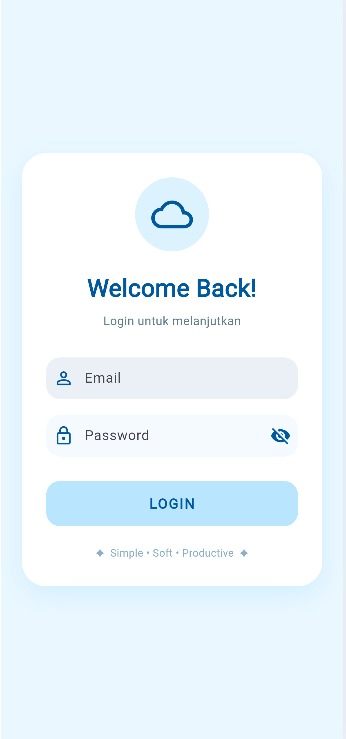

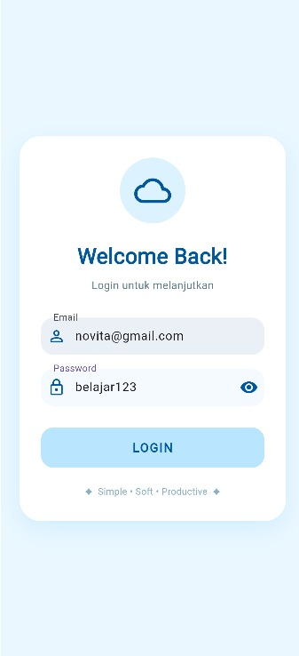

### 2. Dashboard dan Sidebar Navigasi

Dashboard merupakan halaman utama yang ditampilkan setelah pengguna berhasil melakukan login. Halaman ini menyediakan akses ke fitur-fitur pengelolaan data siswa melalui menu navigasi sidebar.

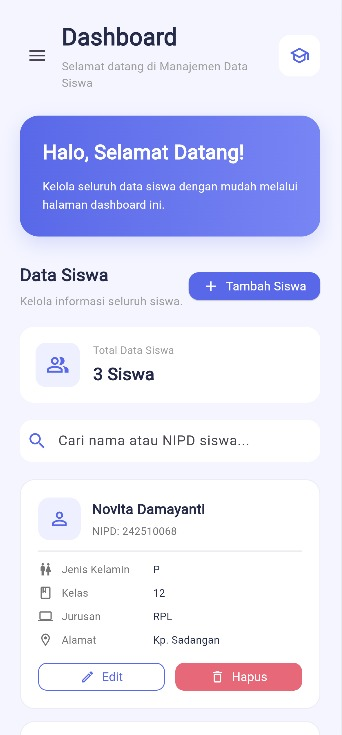

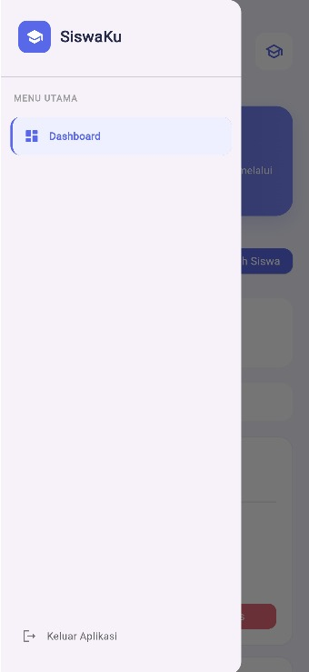

### 3. Fitur Input Data Siswa

Fitur input data siswa digunakan untuk menambahkan informasi siswa baru ke dalam database. Pengguna dapat memasukkan informasi seperti NIPD, nama lengkap, jenis kelamin, alamat, kelas, dan jurusan.

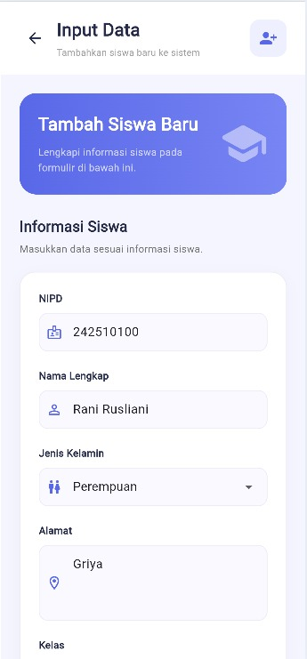

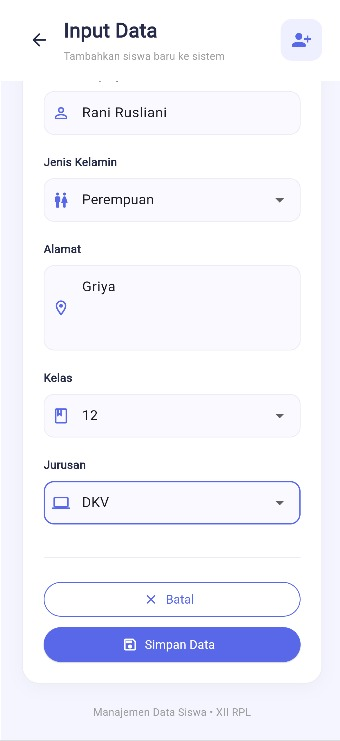

**Hasil Input Data Berhasil**

Setelah data siswa berhasil dimasukkan, sistem akan memberikan pemberitahuan bahwa proses penyimpanan telah berhasil dilakukan.

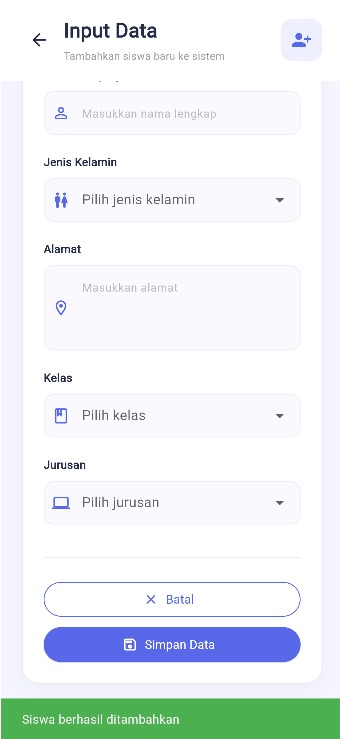


### 4. Fitur Pencarian Data Siswa Berdasarkan NIPD

Fitur pencarian digunakan untuk menemukan data siswa secara spesifik berdasarkan **NIPD (Nomor Induk Peserta Didik)**.

NIPD digunakan sebagai identitas unik setiap siswa sehingga satu siswa memiliki satu data dengan nomor identitas yang berbeda dari siswa lainnya. Melalui fitur ini, pengguna dapat melakukan pencarian data dengan memasukkan NIPD siswa yang ingin ditemukan.

Penggunaan NIPD sebagai identitas unik membantu menghindari kesalahan dalam pencarian data serta memudahkan proses identifikasi siswa di dalam sistem.

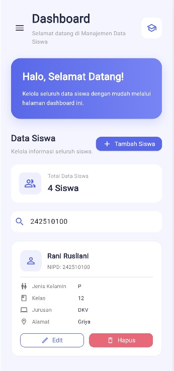

### 5. Fitur Edit Data Siswa

Fitur edit data digunakan untuk memperbarui informasi siswa yang telah tersimpan di dalam database. Pengguna dapat memilih data siswa yang ingin diperbarui, kemudian mengubah informasi sesuai kebutuhan.

**Tampilan Form Edit Data**

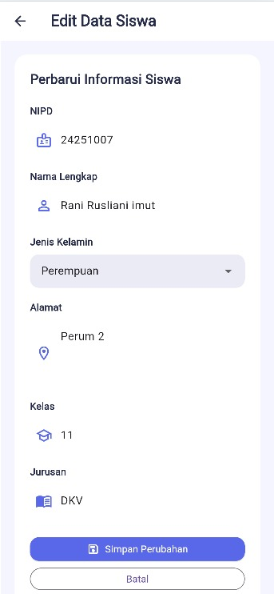

**Hasil Edit Data Berhasil**

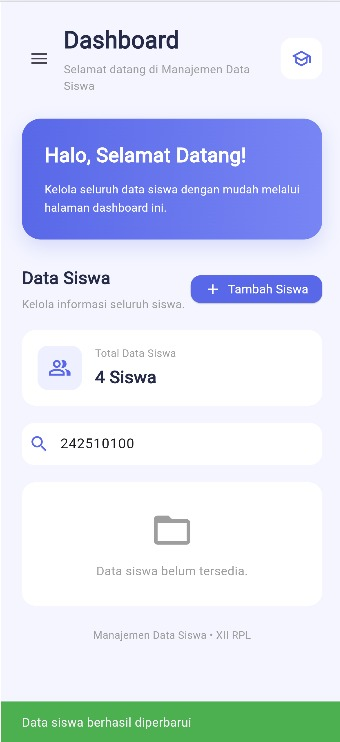

### 6. Fitur Hapus Data Siswa

Fitur hapus data digunakan untuk menghapus informasi siswa tertentu dari database apabila data tersebut sudah tidak diperlukan atau perlu dihapus.

**Proses Penghapusan Data**

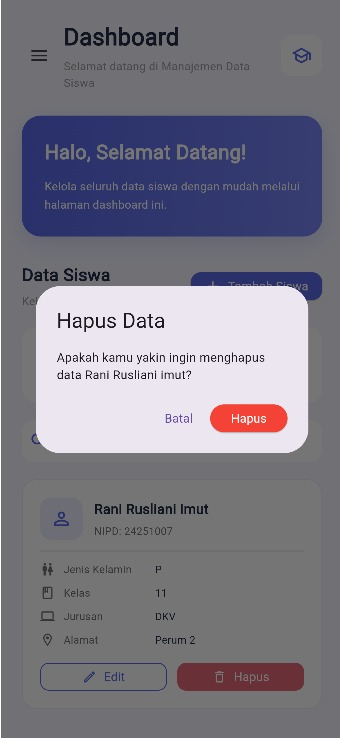

**Hasil Hapus Data Berhasil**

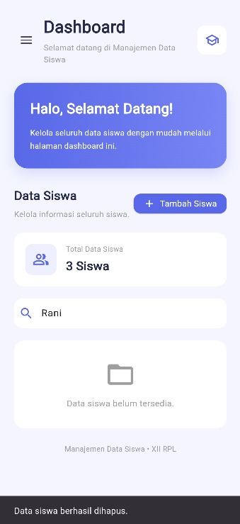

Setelah proses penghapusan berhasil, data siswa yang dipilih tidak lagi ditampilkan dalam daftar data siswa.

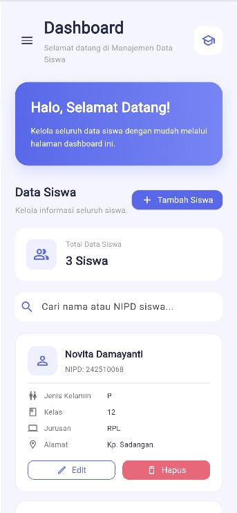

### 7. Kesimpulan Hasil Implementasi

Berdasarkan dokumentasi tampilan aplikasi di atas, sistem telah menyediakan beberapa fungsi utama pengelolaan data siswa, yaitu autentikasi pengguna, penambahan data, pencarian berdasarkan NIPD, pengeditan data, serta penghapusan data siswa.

Setiap fitur tersebut dikembangkan untuk membantu proses pengelolaan data siswa agar lebih terstruktur dan mudah digunakan.